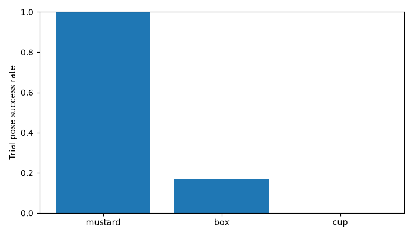
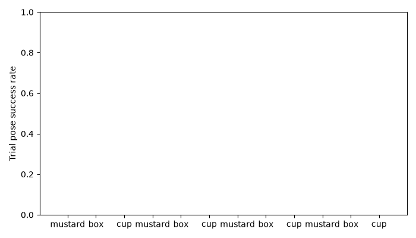

# r3 회사 GPU 평가 진행

Unix 갱신: 1794197198.702
GT oracle identity/click, known extrinsics/contact association 사용. GT-assist off도 deployable perception-only 아님.
사용자 테스트 동시 진행: 2026-11-09 13:03 이후 새 측정 cold/warm 지연은 동시작업 수치. 슬롯 전체 최대90초.
Wilson95 분모=계획 N30/N20. 미실행/timeout/누락 trial도 실패로 포함. 진행 중의 수치는 잠정 하한이며 최종 PASS 아님.

|단계|perception|GT assist|물체|완료/계획|누락 실패|pose Wilson95|pick Wilson95|place Wilson95|cold/warm register median s|
|-|-|-|-|-:|-:|-|-|-|-|
|matrix|fp|off|box|0/20|20|0/20 [0.000,0.161]|0/20 [0.000,0.161]|0/20 [0.000,0.161]|-/-|
|matrix|fp|off|cup|0/20|20|0/20 [0.000,0.161]|0/20 [0.000,0.161]|0/20 [0.000,0.161]|-/-|
|matrix|fp|off|mustard|0/20|20|0/20 [0.000,0.161]|0/20 [0.000,0.161]|0/20 [0.000,0.161]|-/-|
|matrix|fp|on|box|0/20|20|0/20 [0.000,0.161]|0/20 [0.000,0.161]|0/20 [0.000,0.161]|-/-|
|matrix|fp|on|cup|0/20|20|0/20 [0.000,0.161]|0/20 [0.000,0.161]|0/20 [0.000,0.161]|-/-|
|matrix|fp|on|mustard|0/20|20|0/20 [0.000,0.161]|0/20 [0.000,0.161]|0/20 [0.000,0.161]|-/-|
|matrix|gt|off|box|0/20|20|0/20 [0.000,0.161]|0/20 [0.000,0.161]|0/20 [0.000,0.161]|-/-|
|matrix|gt|off|cup|0/20|20|0/20 [0.000,0.161]|0/20 [0.000,0.161]|0/20 [0.000,0.161]|-/-|
|matrix|gt|off|mustard|0/20|20|0/20 [0.000,0.161]|0/20 [0.000,0.161]|0/20 [0.000,0.161]|-/-|
|matrix|gt|on|box|0/20|20|0/20 [0.000,0.161]|0/20 [0.000,0.161]|0/20 [0.000,0.161]|-/-|
|matrix|gt|on|cup|0/20|20|0/20 [0.000,0.161]|0/20 [0.000,0.161]|0/20 [0.000,0.161]|-/-|
|matrix|gt|on|mustard|0/20|20|0/20 [0.000,0.161]|0/20 [0.000,0.161]|0/20 [0.000,0.161]|-/-|
|pilot|fp|on|box|5/30|25|5/30 [0.073,0.336]|비대상|비대상|26.170/3.588|
|pilot|fp|on|cup|0/30|30|0/30 [0.000,0.114]|비대상|비대상|-/-|
|pilot|fp|on|mustard|30/30|0|30/30 [0.886,1.000]|비대상|비대상|25.956/2.357|

총 계획 330 trials = FP N30/object 90 + matrix N20/object 240. 5frames/trial. 청크 첫 register=cold, 나머지=warm(추론된 초기화 위치, 캐시 상태 보장 아님). Track FPS는 등록 후 actual-wall 기준. 기존 결과 덮어쓰기 없음.

진행 35/330; observed 30.2 trial/h; adaptive ETA 2026-11-09T16:37:01+09:00 (queue assumed 0.0s/chunk, provisional).

## 13:08 재개 상태
- 최신 원자료 **40/330 완료**. 위35/330 표는 이전 집계이며 새집계 이중락 대기 중.
- 사용자테스트13:06종료, 적응형target210초/전체최대240초 복원.
- 기존16:37 ETA는 이전90초계획/당시대기값이므로 현재예측으로사용금지. 새속도·ETA는exec1040이락획득후자동갱신.
- 13:03~13:06시간창의동시진행표시유지.
